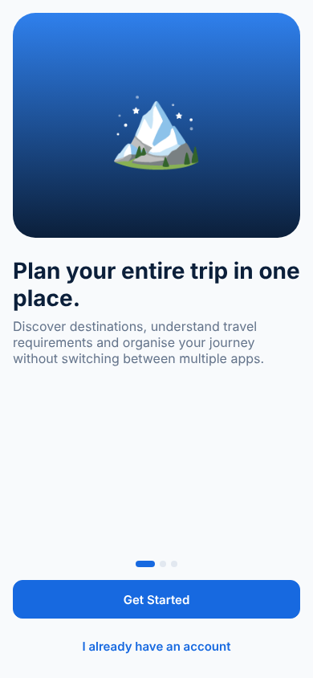

# Travel OS

**Plan your entire trip in one place.** Travel OS is a cross-platform travel planning app that brings destination discovery, entry requirements, itineraries, budgets and checklists together. It runs on Android, iOS and the web from a single codebase.

**[▶ Open the live web app](https://rupeshkumar7.com/travel-os)** · [Project write-up](https://rupeshkumar7.com/projects/travel-os)

<p align="center">
  
</p>

---

## Features

| Area | What it does |
|---|---|
| **India catalogue** | 263 destinations and 300+ attractions across all 28 states and 8 union territories, organised by region → state/UT → destination ([details](data/india/README.md)) |
| **Explore** | Browse by region and state, filter by category, month, trip length, budget level and type; server-side paginated search across names, alternate spellings, states and attractions |
| **Discover** | Travel circuits, "near me" (straight-line distance), compare up to three destinations, share links, nearby destinations |
| **Travel readiness** | Documents, permits, local rules and safety information for each destination, always shown with a source and a last-verified date |
| **Trip builder** | Dates, adults/children, budget, pace, travel style, interests, stay, food and accessibility preferences; day-wise itinerary in geographic order that respects known closures |
| **AI planner** | Anthropic Claude, grounded in the catalogue (may only use known places), validated server-side; regenerate a single day |
| **Budget** | Budget calculator (budget/standard/premium, per person and total, editable lines, documented assumptions), per-trip categories and expenses |
| **Checklist** | Preparation and packing tasks with priorities |
| **Maps** | Destination and trip maps (Leaflet + OpenStreetMap, no API key); directions open in the device's map app |
| **Account** | Email/password sign-up with email verification (resend link, expired-link handling), password reset, profile, preferences, saved items and notifications |
| **Admin console** | Manage destinations and requirements, review reports, and a data-quality audit (coverage, stale permits, duplicates, missing fields) |

## Tech stack

- **App:** [Expo](https://expo.dev) SDK 57 · React Native 0.86 · React 19 · TypeScript
- **Navigation:** Expo Router (file-based routes in `src/app/`)
- **Data:** [Supabase](https://supabase.com) (PostgreSQL, Auth, row-level security on every table) · TanStack Query
- **Maps:** Leaflet + OpenStreetMap
- **Builds:** Expo Application Services (EAS) for Android/iOS; static web export

## Project structure

```
src/
  app/                 screens (Expo Router — every file is a route)
    (auth)/            welcome, login, register, forgot password
    (tabs)/            home, explore, map, trips, profile
    trip/[id]/         trip dashboard, itinerary, budget, checklist, map
    destination/  attraction/  requirements/   content screens
    admin/             admin console
  components/          shared UI (cards, map, design-system primitives)
  hooks/               data hooks (Supabase + TanStack Query)
  lib/                 Supabase client, theme, types, formatting, notifications
  providers/           authentication context
assets/                app icons and splash screen
```

## Getting started

**Prerequisites:** Node.js 20+ and npm. For a phone, install the **Expo Go** app.

```bash
git clone https://github.com/rupeshkarn7-art/travel-os.git
cd travel-os
npm install
cp .env.example .env        # add your Supabase URL and publishable key
npm start                   # scan the QR code with Expo Go, or press w for web
```

| Variable | Description |
|---|---|
| `EXPO_PUBLIC_SUPABASE_URL` | Supabase project URL |
| `EXPO_PUBLIC_SUPABASE_KEY` | Supabase publishable (anon) key — safe for client apps |
| `EXPO_PUBLIC_ENABLE_GOOGLE` | `true` to show Google sign-in (requires the Google provider in Supabase) |
| `EXPO_PUBLIC_SUPPORT_EMAIL` | Address shown on the Help screen |

### Useful scripts

```bash
npm run typecheck           # TypeScript check
npm run web                 # run in the browser
npm run build:web           # production web build → dist/
```

## Deployment

**Web.** `npm run build:web` produces a static site in `dist/`. The app is configured to live under `/travel-os` (`experiments.baseUrl` in `app.json`) and is currently hosted on [rupesh-kumar-website](https://github.com/rupeshkarn7-art/rupesh-kumar-website). Any static host works, as long as unknown paths fall back to `index.html`. To serve it from a domain root, remove `baseUrl`.

**Android.** Build an installable APK in the cloud:

```bash
npx eas-cli@latest build -p android --profile preview
```

Use the `production` profile to build an app bundle for the Google Play Store.

**iOS.** Requires an Apple Developer account. Build with `npx eas-cli@latest build -p ios`, then distribute through TestFlight or the App Store.

**Email verification.** In Supabase → Authentication → Sign In / Providers → Email, turn on **Confirm email**. New users then land on a *Verify your email* screen and can only sign in after opening the link. Supabase's built-in mailer is for testing only, so configure custom SMTP (Authentication → Emails → SMTP Settings) before launch.

**Auth redirects.** In Supabase → Authentication → URL Configuration, add each web address the app runs on (e.g. `https://your-domain/travel-os/**`) and `travelos://**` for the native app. This makes sign-up confirmation and password-reset links return to the app.

### Environment and secrets

| Where | Name | Purpose |
|---|---|---|
| App (`.env`) | `EXPO_PUBLIC_SUPABASE_URL`, `EXPO_PUBLIC_SUPABASE_KEY` | Supabase project and publishable key |
| Supabase → Edge Functions → Secrets | `ANTHROPIC_API_KEY` | Enables the AI planner (server-side only, never in the app) |
| Supabase → Edge Functions → Secrets | `ANTHROPIC_MODEL` (optional) | Defaults to `claude-sonnet-5-5` |

### Database

Migrations live in `supabase/migrations` (005 catalogue schema, 006 importer/search/planner functions). The catalogue is
imported from `data/india/out/catalogue.json` — see [data/india/README.md](data/india/README.md).

## Security

- Row-level security is enabled on every table, so users can only read and change their own trips, expenses and checklists.
- On mobile, the auth session is AES-encrypted and the key is kept in the device keystore (`expo-secure-store`).
- No secrets are committed. `.env` is git-ignored, and only the Supabase *publishable* key is used on the client.

## Roadmap

- Publish the Android app on Google Play
- AI-assisted itinerary suggestions
- Offline access to trip details
- Shared trips for groups

## Author

**Rupesh Kumar** · [Website](https://rupeshkumar7.com) · [GitHub](https://github.com/rupeshkarn7-art)

## License

[MIT](LICENSE)
